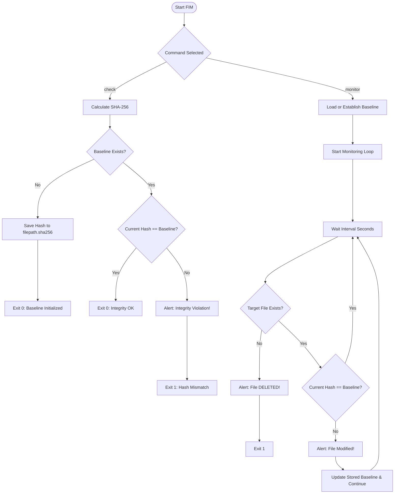

# File Integrity Monitor (FIM)

[](https://www.python.org/)
[](LICENSE)
[](#prerequisites)
[](#)

A lightweight, zero-dependency, cross-platform **File Integrity Monitor (FIM)** written in Python. It detects unauthorized modifications, tampering, and deletion of critical system files, configuration files, and application assets using **SHA-256** cryptographic hashing.

---

## Table of Contents

- [Overview](#overview)
- [How It Works](#how-it-works)
- [Key Features](#key-features)
- [Prerequisites](#prerequisites)
- [Installation](#installation)
- [Usage Guide](#usage-guide)
  - [CLI Syntax](#cli-syntax)
  - [1. Single Check Mode (`check`)](#1-single-check-mode-check)
  - [2. Continuous Monitoring Mode (`monitor`)](#2-continuous-monitoring-mode-monitor)
- [Step-by-Step Hands-on Demo](#step-by-step-hands-on-demo)
- [Exit Codes & Automation](#exit-codes--automation)
- [Project Structure](#project-structure)
- [Security Considerations & Best Practices](#security-considerations--best-practices)
- [Contributing](#contributing)
- [License](#license)

---

## Overview

In security operations and system administration, verifying that critical files have not been modified or deleted is a fundamental defensive requirement. Adversaries, unauthorized users, or rogue software often modify binaries, web assets, or system configuration files (such as `/etc/passwd`, Windows registry exports, `.env` secrets, or web application source code).

This File Integrity Monitor provides:
- **Baseline Integrity Establishment:** Computes a cryptographic SHA-256 hash snapshot of the file and stores it in `<filepath>.sha256`.
- **Integrity Validation:** Performs point-in-time checks against previously stored baselines.
- **Continuous Real-Time Alerting:** Loops at user-defined intervals to detect modifications or file deletions as they happen.

---

## How It Works



1. **Chunked Hashing:** Files are read in 4096-byte blocks via Python's standard `hashlib`, preventing memory spikes on large files.
2. **Persistent Baselines:** The baseline hash is stored in an adjacent metadata file `<filepath>.sha256`.
3. **Real-time Loop:** In `monitor` mode, the script polls the target file every $N$ seconds (default: 3 seconds) and triggers timestamped alerts upon alteration or deletion.

---

## Key Features

- **Zero Third-Party Dependencies:** Uses only Python standard library modules (`argparse`, `hashlib`, `os`, `sys`, `time`). No `pip install` required.
- **Strong Cryptography:** SHA-256 algorithm ensures collision resistance and tamper evidence.
- **Chunk-based Streaming:** Safely hashes files of any size without loading entire files into memory.
- **Automated Baseline Management:** If a baseline does not exist during a check or monitor run, it automatically captures and writes the initial baseline.
- **Immediate Alerting:** Pinpoints exact timestamp, expected hash, and current observed hash.
- **Deletion Detection:** Explicitly catches when a monitored file has been removed or renamed.
- **Cross-Platform:** Runs identically on Windows (Command Prompt, PowerShell), Linux, and macOS.

---

## Prerequisites

- **Python 3.6+** installed on your system.
  Verify with:
  ```bash
  python --version
  # or
  python3 --version
  ```

---

## Installation

Clone the repository to your local machine:

```bash
git clone https://github.com/Cyb3rflex/fileintegritymonitor.git
cd fileintegritymonitor
```

No additional dependencies are needed.

---

## Usage Guide

### CLI Syntax

```text
python fim.py [-h] [--interval INTERVAL] {check,monitor} filepath
```

#### Arguments & Options

| Parameter | Type | Required | Default | Description |
| :--- | :--- | :--- | :--- | :--- |
| `command` | Positional | **Yes** | — | Action to execute: `check` or `monitor`. |
| `filepath` | Positional | **Yes** | — | Target path of the file to check or monitor. |
| `--interval` | Optional Flag | No | `3` | Polling frequency in seconds (applicable to `monitor`). |
| `-h`, `--help` | Flag | No | — | Displays the command line usage information. |

---

### 1. Single Check Mode (`check`)

Use `check` to perform a one-time integrity assessment. This is ideal for scheduled cron jobs, CI/CD pipeline verification, or pre/post-deployment sanity checks.

#### First Run (Initializes Baseline)
When run for the first time against a file with no `.sha256` file present, it calculates and stores the baseline:

```bash
python fim.py check sample.txt
```
**Output:**
```text
[*] File: sample.txt
[+] SHA-256: 2c26b46b68ffc68ff99b453c1d30413413422d706483bfa0f98a5e886266e7ae
[+] Baseline saved to: sample.txt.sha256
```

#### Subsequent Runs (Integrity Intact)
```bash
python fim.py check sample.txt
```
**Output:**
```text
[*] File: sample.txt
[+] SHA-256: 2c26b46b68ffc68ff99b453c1d30413413422d706483bfa0f98a5e886266e7ae
[+] Integrity OK: file matches the stored baseline.
```

#### If Tampering Occurs
If the file content has changed:
```bash
python fim.py check sample.txt
```
**Output:**
```text
[*] File: sample.txt
[+] SHA-256: a665a45920422f9d417e4867efdc4fb8a04a1f3fff1fa07e998e86f7f7a27ae3
[!!!] ALERT: 2026-10-30 14:15:20 - INTEGRITY VIOLATION! File modified.
    Expected: 2c26b46b68ffc68ff99b453c1d30413413422d706483bfa0f98a5e886266e7ae
    Found:    a665a45920422f9d417e4867efdc4fb8a04a1f3fff1fa07e998e86f7f7a27ae3
```

---

### 2. Continuous Monitoring Mode (`monitor`)

Use `monitor` to track a critical file in real-time. The script stays active, checking the file periodically and warning immediately if changes occur.

#### Run with default 3-second interval:
```bash
python fim.py monitor config.json
```

#### Run with custom interval (e.g., every 10 seconds):
```bash
python fim.py monitor config.json --interval 10
```

**Output:**
```text
[*] Establishing baseline for: config.json
[+] Baseline Hash: 68631b79f0fb8df4336214ab60b9ee2761bece6a16c14101d7100b702ec4c9a8
[*] Monitoring started... Press Ctrl+C to stop.

[!!!] ALERT: 2026-10-30 14:18:05 - INTEGRITY VIOLATION! File modified.
    Expected: 68631b79f0fb8df4336214ab60b9ee2761bece6a16c14101d7100b702ec4c9a8
    Found:    9f83c605ced7bb3d13499e0f074f499472b25cb297e23b1b6245372b41972332
```

Press `Ctrl + C` at any time to cleanly stop monitoring.

---

## Step-by-Step Hands-on Demo

Here is a quick walkthrough you can run in your terminal to see the tool in action:

### On Windows (PowerShell):

```powershell
# 1. Create a dummy test file
Set-Content -Path "test.txt" -Value "original data"

# 2. Run initial check to create baseline
python fim.py check test.txt

# 3. Verify clean status
python fim.py check test.txt

# 4. Simulate tampering
Add-Content -Path "test.txt" -Value "tampered line"

# 5. Run check to detect violation
python fim.py check test.txt

# 6. Test real-time monitoring
python fim.py monitor test.txt --interval 2
```

### On Linux / macOS (Bash/Zsh):

```bash
# 1. Create a dummy test file
echo "original data" > test.txt

# 2. Run initial check to create baseline
python3 fim.py check test.txt

# 3. Verify clean status
python3 fim.py check test.txt

# 4. Simulate tampering
echo "tampered line" >> test.txt

# 5. Run check to detect violation
python3 fim.py check test.txt

# 6. Test real-time monitoring
python3 fim.py monitor test.txt --interval 2
```

---

## Exit Codes & Automation

FIM returns standard process exit codes so it can be integrated into automation scripts, batch files, or alerting systems:

| Exit Code | Meaning | Context |
| :---: | :--- | :--- |
| `0` | **Success / OK** | File integrity matches baseline, or baseline was successfully established, or monitoring was cleanly stopped by user. |
| `1` | **Alert / Failure** | Integrity violation detected, file missing/deleted, or invalid arguments. |

### Example in CI/CD or Scheduled Bash Script:
```bash
if ! python3 fim.py check /etc/nginx/nginx.conf; then
    echo "CRITICAL: Configuration file compromised!" | mail -s "FIM ALERT" admin@example.com
fi
```

### Example in PowerShell Automation:
```powershell
python fim.py check C:\inetpub\wwwroot\web.config
if ($LASTEXITCODE -ne 0) {
    Write-Warning "Integrity alert triggered on web.config!"
}
```

---

## Project Structure

```text
fileintegritymonitor/
│
├── fim.py                  # Core File Integrity Monitor application
├── README.md               # Detailed documentation and usage instructions
├── .gitignore              # Ignores Python caches and temporary baseline files
└── <watched_file>.sha256   # Generated baseline hash file (created per monitored file)
```

---

## Security Considerations & Best Practices

1. **Protect the Baseline Files (`*.sha256`):**
   - If an attacker gains full write permissions to the file system, they could modify both the target file and the `.sha256` baseline file simultaneously.
   - Restrict access to the `.sha256` baseline files using OS file permissions (`chmod 400` / `chmod 600` on Linux, restrictive ACLs on Windows) or store them on a read-only partition / remote server.
2. **Dedicated Read-Only User:**
   - Run the monitoring script with a dedicated least-privilege service account that only possesses read access to the monitored files and write access to its designated baseline directory.
3. **Log Aggregation:**
   - Redirect stdout to log files or forward them into a SIEM / log collection agent (e.g., Splunk, Wazuh, ELK) for persistent audit trails.

---

## Contributing

Contributions, issues, and feature requests are welcome!
Feel free to open an issue or submit a pull request:

1. Fork the Project
2. Create your Feature Branch (`git checkout -b feature/AmazingFeature`)
3. Commit your Changes (`git commit -m 'Add some AmazingFeature'`)
4. Push to the Branch (`git push origin feature/AmazingFeature`)
5. Open a Pull Request

---

## License

This project is open-source and available under the [MIT License](LICENSE).
